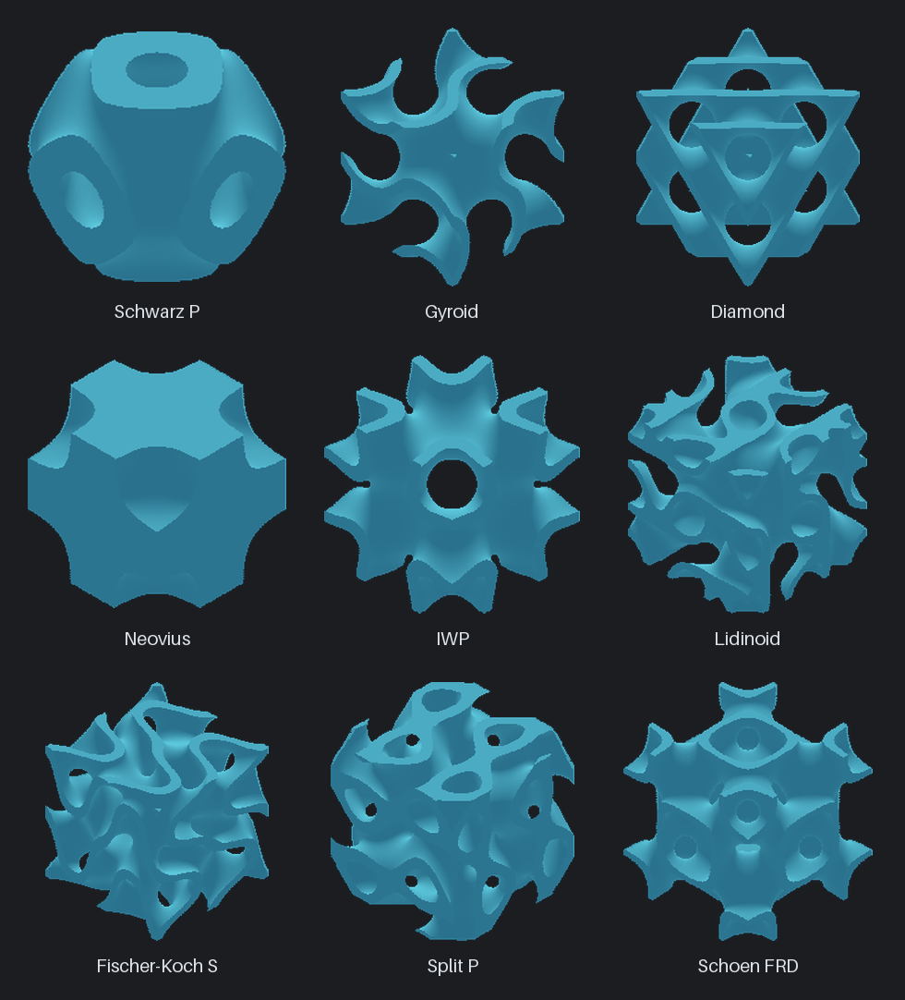

<p align="center">
  
</p>

<h1 align="center">TPMS Generator for Cinema 4D</h1>

<p align="center">
  A native Cinema 4D generator object that builds <b>TPMS (Triply Periodic Minimal Surface)</b> structures —
  Schwarz P, Gyroid, Diamond and more — directly as a clean quad mesh.
</p>

<p align="center">
  <a href="https://aimarnl.github.io/tpms-generator-c4d/">Project page</a> ·
  <a href="https://github.com/AimarNL/tpms-generator-c4d/releases">Download</a> ·
  <a href="https://github.com/AimarNL/tpms-generator-c4d/issues">Report an issue</a>
</p>

---



*The nine structure types. These previews were ray-marched from the same equations the plugin uses (Sheet mode, one cell each); they are not Cinema 4D screenshots.*

## What is it?

A TPMS is a surface defined by an equation `f(x, y, z) = C` that repeats in all three directions. It splits space into two interlocking channels, so it is naturally hollow. TPMS structures are used for lightweight lattices, heat exchangers, bone scaffolds and generative design.

**TPMS Generator** is a Python plugin for Cinema 4D that creates these structures as a procedural object with parameters in the Attributes Manager. No Volume Builder or Volume Mesher is needed, and you can optionally cut the structure to the shape of any closed object.

## Features

- **Nine structure types:** Schwarz P, Gyroid, Diamond (Schwarz D), Neovius, IWP, Lidinoid, Fischer-Koch S, Split P, Schoen FRD.
- **Three modes:** hollow *Sheet* walls, or *Solid A* / *Solid B* (one of the two channels filled).
- **Controllable:** cell size per axis, wall thickness, iso level `C`, phase offset.
- **Quad mesh output** with a Phong tag, built with Surface Nets. Where two thin surfaces share a cell, each gets its own vertex, so thin walls do not fuse together.
- **Cut to a shape:** put a closed object (Cube, Sphere, Boolean result...) under the generator and the structure is cut to it. Use Child Shape is switched on and the child's viewport/render visibility is switched off automatically.
- **Quality by voxel size:** one parameter trades speed for detail.
- **Works without numpy** (slower, smaller grid) and is fast with numpy.
- Own icon and Attributes Manager UI; no external dependencies required.

## Requirements

- Cinema 4D with Python plugin support (developed for Cinema 4D 2027).
- *Optional but recommended:* `numpy` available in Cinema 4D's Python.

## Installation

1. Download the latest release zip, or clone this repository.
2. Copy the **`tpmsgenerator`** folder into Cinema 4D's plugins folder  
   (*Edit > Preferences > Open Preferences Folder*, then `plugins`). Remove any older copy first.
3. Restart Cinema 4D.
4. Press **Shift+C**, type `TPMS Generator` and create the object.

```
tpmsgenerator/
  tpmsgenerator.pyp              plugin code
  res/
    c4d_symbols.h
    icons/tpms_generator.png     plugin icon
    description/                 parameter UI (.res, .h)
    strings_us/                  UI texts (.str)
```

## Quick start

1. Create a **TPMS Generator**. By default it fills a 400 × 400 × 400 cm box with a Schwarz P sheet structure.
2. Change **Type**, **Mode**, **Cell Size** and **Thickness** to shape the structure.
3. To cut it to a shape: drag a closed object (for example a Sphere) **under** the TPMS Generator in the Object Manager. The plugin switches on *Use Child Shape* and hides the child in the viewport and renderer.
4. Keep **Voxel Size** large (8–10) while editing; reduce it (3–4) for the final result.

## Parameters

| Parameter | Default | What it does |
|---|---|---|
| **Type** | Schwarz P | Schwarz P, Gyroid, Diamond (Schwarz D), Neovius, IWP, Lidinoid, Fischer-Koch S, Split P, Schoen FRD. |
| **Mode** | Sheet | **Sheet (hollow walls):** only the wall is kept, both channels stay empty. **Solid A (f < C):** one channel is filled. **Solid B (f > C):** the other channel is filled. |
| **Cell Size** | 100, 100, 100 cm | Size of one repeating cell in X, Y and Z. Different values stretch the structure. |
| **Thickness** | 0.4 | Wall thickness in Sheet mode, in normalised field units (0–2), not a length in cm. Ignored in Solid modes. |
| **Level (C)** | 0 | The iso-value `C`. At 0 both channels have equal volume; other values enlarge one channel; extreme values break up or remove the structure. |
| **Phase Offset** | 0, 0, 0 cm | Shifts the pattern inside the region. |
| **Voxel Size** | 4 cm | Grid spacing and the main quality control. Smaller = finer mesh, more polygons, slower. A sheet wall should be at least ~2 voxels thick. |
| **Max Grid Points** | 4,000,000 | Safety limit for the grid size. If `Voxel Size` would exceed it, the voxel size is raised automatically and the Console prints a message. |
| **Use Child Shape** | off | Off: fills `Box Size`. On: the first child object defines the shape (closed mesh) and the structure is cut to it. Switched on automatically when you place an object under the generator. |
| **Box Size** | 400, 400, 400 cm | Size of the box filled when `Use Child Shape` is off (or there is no child). |
| **Margin** | 0 cm | Enlarges the sampled region around the box or shape. |

### Choosing a voxel size

With the default Thickness (0.4) and Cell Size (100), a Voxel Size of **4** is clean for most types. **Lidinoid** and **Fischer-Koch S** have thinner walls in Sheet mode; use **3 or lower** for those. In general: wall thickness ≥ 2 voxels.

## numpy and performance

- **With numpy:** about 5 s for 1.2 million vertices from an 8-million-point grid in tests outside Cinema 4D; about 0.5 s for the default settings (not counting the time Cinema 4D needs to create the polygon object).
- **Without numpy** (some Cinema 4D installations do not include it): the plugin still works using a pure-Python path that produces the same mesh but is much slower. The grid is limited to **300,000 points**; the voxel size is raised automatically if needed and the Console says so. Make numpy available to Cinema 4D's Python for finer results (see Maxon's documentation on installing Python packages; steps for your version are not verified here).
- The mesh is rebuilt **only** when a parameter or the child shape changes. Each rebuild prints a line like `[TPMS] built 299136 polygons in 0.91 s (parameters changed)` in the Console. If that line keeps appearing while you only orbit the viewport, please open an issue with the lines you see.

## How it works

1. A 3D grid covers the region (the box, or the child's bounding box) with spacing `Voxel Size`.
2. The chosen TPMS function is evaluated on the grid and turned into a sheet or solid field (`Mode`, `Thickness`, `Level (C)`).
3. The structure is cut exactly at the box faces, or to the child shape: rays along X, Y and Z find which grid points are inside, and the three axes vote.
4. **Surface Nets** extracts a quad mesh. Cells containing two separate surface pieces get one vertex per piece.
5. A Phong tag (angle limit 60°) is added.

## Troubleshooting

| Problem | What to do |
|---|---|
| Viewport very slow | Check the Console for repeated `[TPMS] built ...` lines. Increase `Voxel Size`. |
| `numpy not found` in the Console | The slower pure-Python path is used (grid limited to 300,000 points). Make numpy available for speed and detail. |
| Rough surface or touching walls | The wall is thinner than ~2 voxels. Reduce `Voxel Size` or raise `Thickness`. |
| Nothing is generated | Look for `[TPMS] error:` in the Console. With `Use Child Shape` on, the child must be a closed mesh and the first child. |
| Does not update after editing the child | Please report it (see Status). |
| Plugin missing or UI empty | Check the Console at startup; check the plugin ID conflict (below); make sure the whole `res` folder sits next to `tpmsgenerator.pyp`. |

## Plugin IDs

The plugin uses Maxon's shared **test** IDs: `1000008` (the generator, `PLUGIN_ID` at the top of `tpmsgenerator.pyp`) and `1000009` (a small helper that handles child objects, `PLUGIN_ID + 1`). IDs 1000001–1000010 are a test range shared by all developers, so they can clash with other plugins. If Cinema 4D reports a conflict, change `PLUGIN_ID`. Register your own free ID at [developers.maxon.net](https://developers.maxon.net/) before distributing a modified build. Scenes saved with one ID do not recognise the object after the ID is changed.

## Status and limitations

- The mesh generation (field, Surface Nets, numpy and pure-Python paths) was verified outside Cinema 4D with test scripts.
- The following have **not** been run inside Cinema 4D by the author: plugin registration, the `res/` UI files, icon loading, reading a real child object, the automatic child setup, and the rebuild/caching behaviour. Please open an issue with any Console output.
- Features below about 2 voxels cannot be represented exactly. Clipping to a child shape is approximate near the shape's surface and exact at the box faces. Only the first child is used, and it must convert to a closed polygon mesh.
- Opening a scene that already has a child under a TPMS Generator makes the plugin treat that child once as "newly placed" (Use Child Shape on, child hidden).

## Contributing

Issues and pull requests are welcome. When reporting a problem, please include your Cinema 4D version, the Console output (lines starting with `[TPMS]`) and the generator's parameter values.

## License

[MIT](LICENSE) © 2026 Aimar

## Credits

TPMS equations follow the standard level-set approximations from the literature. Surface extraction uses the Surface Nets idea (Gibson, 1998), extended with per-piece vertices in ambiguous cells.
